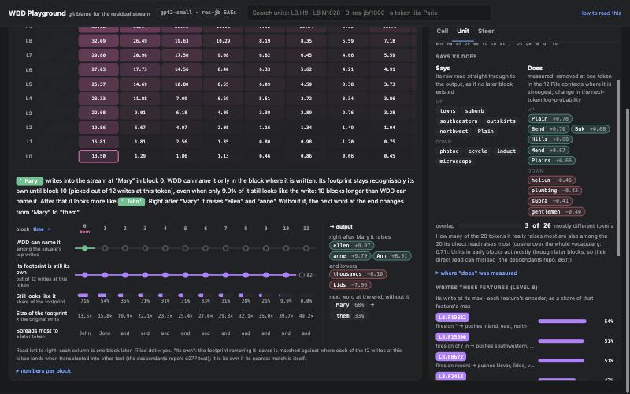

# WDD Playground: git blame for the residual stream

An interactive **provenance explorer for GPT-2 small**. Type a prompt and see, for every token and every layer, **which of the model's own writers built the residual stream there**: MLP neurons, attention heads, token embeddings, and Neuronpedia's res-jb sparse-autoencoder (SAE) features. Then check each answer by exact ablation, steer the model, and follow one write through every later layer to the output.

It is built on **Weight-Dictionary Decomposition (WDD)**: sparse pursuit (OMP) over the model's own write vectors, with a randomly rotated copy of the same dictionary as the noise floor. The research program behind it is [sunmoonron/wdd-descendants](https://github.com/sunmoonron/wdd-descendants).


## What you can do

One core object, the **unit** (`L8.N1028` a neuron, `L9.H9` a head, `L8.F1000` an SAE feature, which Neuronpedia calls `9-res-jb/1000`, or `tok:5335` a token embedding). Every unit gets the same card, and five lenses read the same token x layer canvas:

| Lens | Question it answers |
| --- | --- |
| **Built by** | Which few native writes rebuild this state? (Italic means no better than a randomly rotated dictionary.) |
| **SAE features** | Which res-jb features are strongest here, relative to their max on 1M Pile tokens? |
| **Why** | How much does each square push an objective: the next token, a token *rather than* another, or one neuron's or feature's activation? Split over writers, then **check by removal** for the exact effect. |
| **Steer Δ** | Add or remove units at every token: default vs steered text, next token, and how far every square moved. |
| **Descendants** | Remove one write at one token and follow it, block by block: when WDD stops being able to name it, how long its footprint stays recognisably its own, how much of it is left, where it spreads, and what it changes at the output. |

The unit card shows:
- **Says vs does**: what the write says when read straight through to the output, next to what removing it actually does in the 12 Pile contexts where it is strongest.
- **Written by**: an exact split of a feature's pre-activation over every head, neuron and embedding.
- **Writes these features**, top contexts, the Neuronpedia explanation, and the effect of removing it.

"**Who put it here**" splits any direction in any square exactly over every head's write, every neuron's write, the embeddings and the biases.



## What it shows on the default prompt

"When Mary and John went to the store, John gave a drink to" (the indirect-object-identification prompt of [Wang et al. 2022](https://arxiv.org/abs/2211.00593)). These are the numbers you will see. Use them as a sanity check, not a result:

- **Who put it here.** Along ` Mary` at the last token in block 10, the split names the paper's heads: L9.H9 +12.6 and L9.H6 +11.4 (name movers), L10.H7 −14.0 (a negative name mover), and L10.H0, L10.H2 and L10.H10 (backups).
- **Self-repair.** Removing L9.H9 alone at that token changes the Mary-minus-John log-probability by −0.03. The others repair it ([McGrath et al. 2023](https://arxiv.org/abs/2307.15771), [Rushing & Nanda 2024](https://arxiv.org/abs/2402.15390)).
- **First-order estimates fail.** The gradient × state estimates keep their sign under exact removal for only 5 of the top 12 reasons. The page shows both.
- **Footprints outlive names.** WDD can name the ` Mary` token's write only in block 0, but its footprint stays recognisably its own until block 10. This is the descendants program's main result, live.

## Quick start

A GPU with about 6 GB is comfortable. A CPU works, but every click takes tens of seconds.

```bash
git clone https://github.com/sunmoonron/wdd-playground
cd wdd-playground
pip install -r requirements.txt
# optional but recommended: neuron labels and SAE feature dashboards (56 MB), from the release
curl -LO https://github.com/sunmoonron/wdd-playground/releases/download/v0.1.0/labels.json
curl -LO https://github.com/sunmoonron/wdd-playground/releases/download/v0.1.0/features.pt
python server.py        # the first run downloads GPT-2 small and the res-jb SAEs (about 1.8 GB)
```

Then open http://localhost:8795. The server binds 127.0.0.1 only. To use a remote GPU, tunnel the port with `ssh -N -L 8795:127.0.0.1:8795 <gpu-box>`.

Settings, as environment variables:
- `NDEV`: `cuda`, `cuda:1` or `cpu`.
- `PORT`: default 8795.
- `WDD_SAE_DIR`: a local copy of `jbloom/GPT2-Small-SAEs-Reformatted`.

`python smoke.py` calls every endpoint once and prints what it got. To rebuild the data files yourself, run `label_neurons.py` and `label_features.py`. Each makes one pass over 1M tokens of `NeelNanda/pile-10k`, which takes a few minutes on a GPU.

Tested with torch 2.7.1 and transformers 5.15.1, on a Quadro P4000 (8 GB).

## How it works

- **The native dictionary.** 97,385 unit vectors:
  - the token and position embeddings;
  - every MLP output row;
  - an SVD basis of each head's slice of the output projection;
  - the biases.
  - The state after block L is described with the writers of blocks 0..L.
- **Reading a state.** States are centred on the mean of the model's own samples and normalised. They are then decomposed by orthogonal matching pursuit (k = 8 by default). A pick counts as "above the floor" if its cosine beats the best match from a randomly rotated copy of the same dictionary, which has the same geometry but no provenance.
- **Why.** The gradient of the objective times the state, split over the square's writers by their coefficients. "Check" removes one write at one token and re-runs the model.
- **Who put it here.** The residual stream is exactly the sum of the embeddings, every head's write, every neuron's write and the biases. So any direction is split over them exactly, along the direct path.
- **Descendants.** Remove one write at one token and record the difference at every later layer and token. A footprint is "its own" if, among up to 16 rival writes at the same token, its nearest transplant image is its own. A transplant image is the write added to other Pile text and averaged there (the method of e242, e246 and e277 in wdd-descendants).
- **Says vs does.** "Says" reads the write through the final LayerNorm's gain and the centred unembedding, counting only tokens seen in the corpus sample. "Does" removes the unit at one token in its 12 strongest of up to ~49k Pile contexts and averages the change in next-token log-probability. The overlap of the two top-20 lists is shown.
- **SAEs.** Joseph Bloom's [res-jb residual SAEs](https://huggingface.co/jbloom/GPT2-Small-SAEs-Reformatted), the set [Neuronpedia](https://www.neuronpedia.org) hosts for GPT-2 small. Level L, the state after block L, is Neuronpedia's `{L+1}-res-jb`, and level 11 is `12-res-jb`. Explanations are fetched live from Neuronpedia's public API.

## Read it honestly

- **First-order attributions are estimates.** On the default prompt most of them do not survive exact removal, and a removed head is often repaired downstream. The exact numbers are the ground truth for this prompt only.
- **OMP picks describe a state; they do not explain it.** The descendants program found that the native atoms are not a privileged basis for what a state *does*, and that nothing it built beat direct logit attribution for joint ablations. "Who put it here" and exact removal are the stronger tools here.
- **Logit effects follow the TransformerLens / Neuronpedia convention** (final-norm gain folded in, centred), with tokens absent from the 1M-token sample left out. Otherwise glitch tokens top the late-layer lists.
- **The first token reads high.** Its features often exceed their Pile max, because that corpus never has a token right after the start of a text.
- **Limits.** Prompts are at most 63 tokens, there is one model, and every number is measured on the prompt in front of you.

## Files

| File | What it is |
| --- | --- |
| `server.py` | The model, the dictionary, the SAEs and the JSON API (stdlib HTTP server and PyTorch). |
| `index.html`, `app.js`, `panels.js`, `card.js` | The page: core state and grid, the five lenses, the inspector and unit card. No build step. |
| `label_neurons.py` | Labels for all 36,864 MLP neurons: top contexts, density, promoted tokens → `labels.json`. |
| `label_features.py` | Top contexts and density for all 12 × 24,576 res-jb features → `features.pt`. |
| `smoke.py` | Calls every endpoint once. |

## Related work

- Weight-Dictionary Decomposition and the descendants program: [sunmoonron/wdd-descendants](https://github.com/sunmoonron/wdd-descendants).
- Neuronpedia: https://www.neuronpedia.org. The res-jb SAEs: https://huggingface.co/jbloom/GPT2-Small-SAEs-Reformatted.
- Indirect object identification in GPT-2 small: Wang et al. 2022, https://arxiv.org/abs/2211.00593.
- Self-repair: McGrath et al. 2023, https://arxiv.org/abs/2307.15771. Rushing & Nanda 2024, https://arxiv.org/abs/2402.15390.
- Orthogonal matching pursuit: Pati, Rezaiifar & Krishnaprasad 1993. Tropp 2004, "Greed is good".

## Cite

See `CITATION.cff`. MIT license.

*Keywords: mechanistic interpretability, provenance, attribution, residual stream, weight-dictionary decomposition, sparse dictionary learning, orthogonal matching pursuit, sparse autoencoders, Neuronpedia, GPT-2, circuits, indirect object identification, self-repair, activation steering, ablation, descendants, interpretability tools.*
